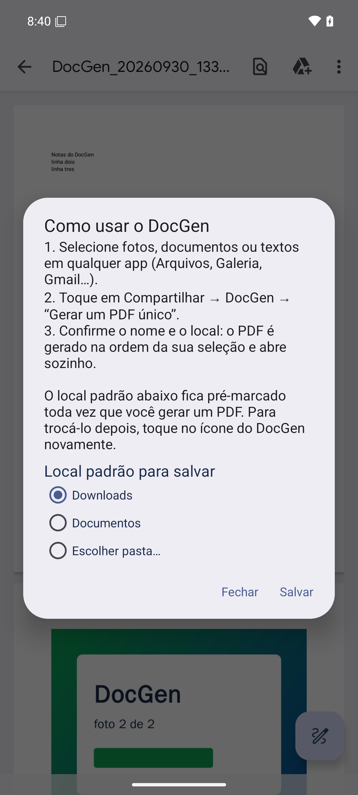
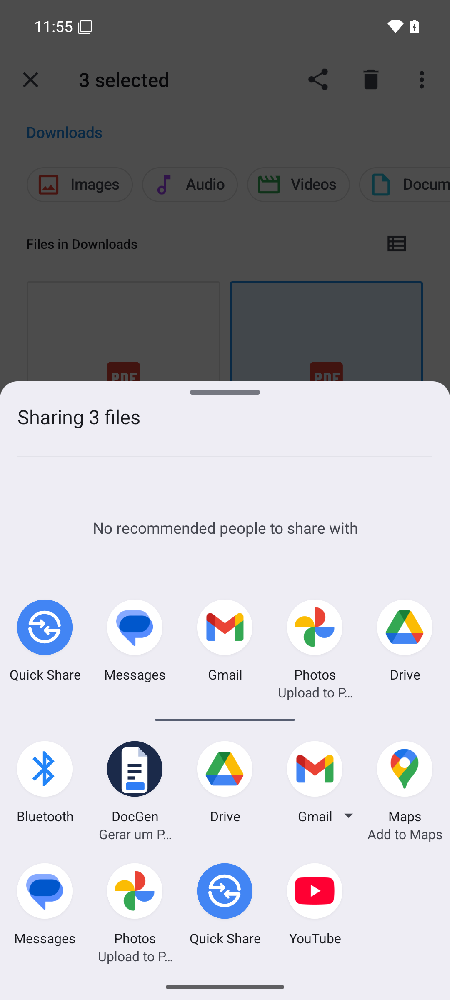
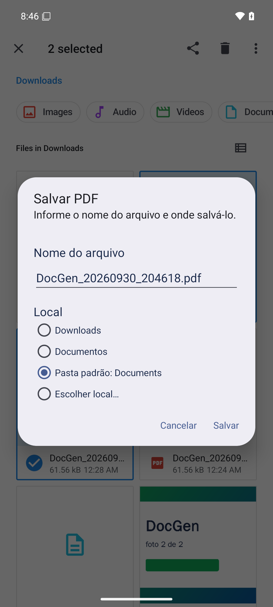
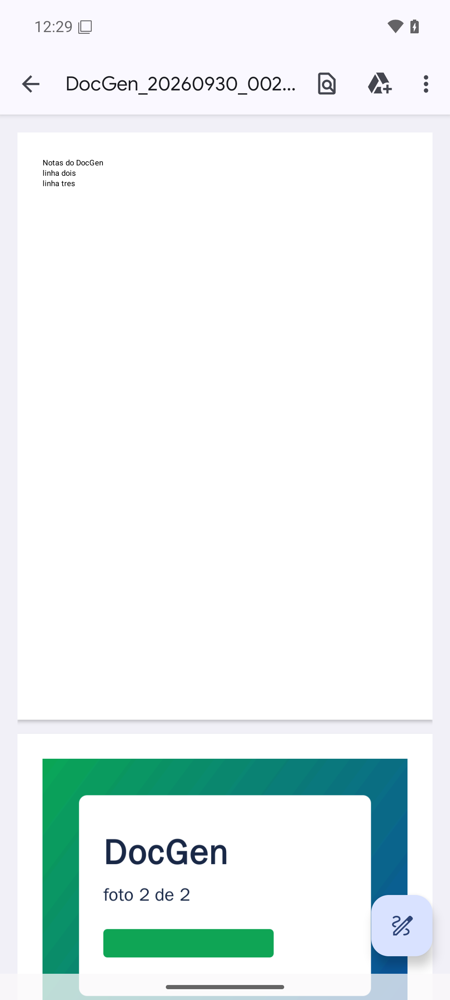

# DocGen

App Android que recebe arquivos enviados pelo **Compartilhar** de qualquer app e gera
**um único PDF** com tudo que você selecionou — na mesma ordem da seleção.

Um toque no botão **“Gerar um PDF único”** no menu de compartilhamento, escolha do nome
e local de gravação, e o PDF pronto já abre no visualizador do Android.

| Ao tocar no ícone | Folha de compartilhamento | Dialog de gravação | Resultado |
| --- | --- | --- | --- |
|  |  |  |  |

---

## 1. O que o MVP faz

* Aparece na folha de compartilhamento nativa (ícone próprio) com a opção
  **“Gerar um PDF único”** para `SEND` e `SEND_MULTIPLE` de qualquer tipo de arquivo.
* Monta **um PDF A4 único** intercalando tudo na ordem em que os itens foram selecionados:
  * **Imagens** (jpg/png/webp/gif/bmp/heic) — empilhadas na mesma página; uma foto de
    página cheia ocupa a página inteira.
  * **PDFs** — rasterizados página a página, cada um começando sempre em página nova.
  * **Textos** (txt/md/csv/json/log/…) — UTF‑8 quebrado em linhas, 51 linhas por página,
    cada arquivo começa em página nova.
* Pede **nome do arquivo** e **local**: Downloads, Documentos ou *Escolher local…*
  (seletor de arquivos do sistema — SAF).
* Grava sem nenhuma permissão: `MediaStore` (scoped storage) ou SAF.
* Abre o resultado no visualizador de PDF instalado no aparelho; se não houver nenhum,
  mostra o caminho do arquivo salvo.
* **Ao tocar no ícone** abre a tela de configuração: instruções de uso e o
  **local padrão de gravação** (Downloads, Documentos ou *Escolher pasta…* via SAF),
  que fica pré-marcado em toda geração posterior. A preferência é gravada em
  `SharedPreferences` e a pasta escolhida tem permissão persistente.

Fora do escopo do MVP (não existe ainda): permissão de pastas, watermark, proteção por
senha, edição, favoritos, múltiplos PDFs, tema escuro completo.

---

## 2. Arquitetura

MVP sem interface extra: **duas activities translúcidas sem tela própria** —
`SetupActivity` (aberta pelo ícone: instruções + local padrão) e `ShareEntryActivity`
(no compartilhamento: gravação → progresso → erro). Cada uma mostra apenas diálogos
nativos; não existe layout de activity, navigation nem ViewModels.

### Camadas

```
br.com.lelis718.docgen
├── share/   SetupActivity          tela do ícone (instruções + local padrão)
│            ShareEntryActivity      orquestrador do compartilhamento
├── core/    núcleo puro Java, sem Android   ← testado em JVM
│   ├── ShareParser, ItemClassifier          intent → itens, MIME/extensão → tipo
│   ├── PdfLayoutPlanner, PdfPlan            algoritmo de layout (cursorY/canAppend)
│   ├── TextTypesetter, ImageFit             quebra de linhas, fit de imagem
│   ├── PageGeometry, Element, PlannedPage   geometria A4 (595×842, margem 36)
│   ├── FileNameRules                        nome do arquivo
│   └── DestinationValue                     destino padrão (downloads/docs/pasta)
├── resolve/ ItemResolver            URI → SourceDescriptor (bytes/dimensões)
├── pdf/     PdfAssembler            executa o plano com PdfDocument/PdfRenderer
└── store/   OutputStore, PdfOpener  MediaStore/SAF + abertura no visualizador
             DestinationPrefs        preferência do local padrão (SharedPreferences)
```

A separação que sustenta o MVP: **`core` não importa nada de `android.*`**. Ele devolve um
`PdfPlan` (páginas com elementos posicionados); quem toca em API do Android é apenas o
`PdfAssembler`. Por isso os 49 testes unitários rodam em segundos na JVM, sem emulador.

### Fluxo de dados

```
Intent (SEND / SEND_MULTIPLE)
  → ShareParser            lista de SharedItem (URI + rótulo)
  → ItemResolver           lê cada URI: dimensões da imagem, nº de páginas do PDF,
                           texto UTF-8 (até 2 MB)
  → PdfLayoutPlanner       decide em que página cada elemento cai:
                           imagem = contain top-aligned + gap 10pt (reusa a página);
                           PDF/texto = sempre página nova. Cursor em `cursorY`.
  → PdfAssembler           página A4 por página, drawBitmap / renderPage / drawText
  → OutputStore            MediaStore Downloads|Documentos ou SAF (IS_PENDING)
  → PdfOpener              ACTION_VIEW + application/pdf (com <queries> no manifest)
```

Estado sobrevive a rotação: a URI de saída fica em `onSaveInstanceState`, então o
diálogo não reaparece e a geração continua.

### Decisões de implementação

| Tema | Decisão |
| --- | --- |
| minSdk 29 | zero permissão de armazenamento (scoped storage + SAF) |
| Abertura | bloco `<queries>` no manifest, sem o qual o `queryIntentActivities` é filtrado e nenhum visualizador aparece |
| Threads | `ExecutorService` de 1 thread + `Handler(main)`: UI nunca bloqueia |
| Texto | `LineMeasurer` injetável no `TextTypesetter` → testeável sem `StaticLayout` |
| Nome | `FileNameRules.sanitize` remove `/ \ : * ? " < > \|` e força `.pdf` |
| Tema | diálogos fixos em `Theme_DeviceDefault_Light_Dialog_Alert` (o app só tem diálogos) |

---

## 3. Manual de instalação

### 3.1 Pré-requisitos

| Item | Versão usada neste projeto |
| --- | --- |
| JDK | 17 |
| Android SDK | API 36 (build-tools/AGP 9.4.1) |
| Gradle | 9.8.0 (wrapper já incluído — `./gradlew` baixa automaticamente) |
| Dispositivo | Android 10+ (API 29), com KVM para emulador |

```bash
# variáveis típicas de um container/estação de trabalho
export ANDROID_HOME=/opt/android-sdk
export PATH=$PATH:$ANDROID_HOME/platform-tools:$ANDROID_HOME/emulator
```

### 3.2 Compilar

```bash
./gradlew assembleDebug      # app/build/outputs/apk/debug/app-debug.apk
./gradlew assembleRelease    # release com R8 (assinar antes de instalar)
./gradlew lint               # análise estática sem issues
```

### 3.3 Instalar em emulador

```bash
# cria o AVD uma única vez (API 36, com KVM)
avdmanager create avd -n docgen -k "system-images;android-36;google_apis;x86_64" -d pixel_6
emulator -avd docgen -netdelay none -netspeed full &

adb install -r app/build/outputs/apk/debug/app-debug.apk
```

Instalar em aparelho físico: `adb install -r app-debug.apk` com depuração USB ativa.

### 3.4 Gerar o pacote assinado para a Play Store

Crie a chave de upload (uma única vez; **guarde o arquivo e as senhas**):

```bash
keytool -genkeypair -v -keystore upload-keystore.jks -keyalg RSA -keysize 2048 \
        -validity 10000 -alias upload
```

Crie `keystore.properties` na raiz (arquivo local, está no `.gitignore`):

```properties
storeFile=upload-keystore.jks
storePassword=<senha do keystore>
keyAlias=upload
keyPassword=<senha da chave>
```

As variáveis de ambiente `DOCGEN_KEYSTORE`, `DOCGEN_STOREPASS`, `DOCGEN_KEYALIAS`
e `DOCGEN_KEYPASS` têm prioridade sobre o arquivo. Sem `keystore.properties` o
release é gerado **sem assinatura** (útil só para compilar).

```bash
./gradlew bundleRelease                     # → app/build/outputs/bundle/release/app-release.aab
./gradlew assembleRelease                   # → app/build/outputs/apk/release/app-release.apk (assinado)
keytool -printcert -jarfile app/build/outputs/bundle/release/app-release.aab | head -6
```

### 3.5 Testar o fluxo completo

1. Abra *Arquivos* → *Downloads* → selecione 2 ou mais itens (imagens, PDF, .txt).
2. Menu de compartilhamento → **DocGen** → **“Gerar um PDF único”**.
3. Nome pré‑preenchido (`DocGen_AAAAmmdd_HHmmss.pdf`) → **Salvar**.
4. O PDF é gravado e abre automaticamente no visualizador.

Capturas reais desse fluxo estão em [`docs/`](docs/).

---

## 4. Testes

```bash
./gradlew test                      # 49 unitários (JVM) — core/*
./gradlew connectedDebugAndroidTest # E2E no emulador: ShareEntryActivityTest
```

O teste instrumentado monta 4 itens mistos (2 imagens coloridas + texto), executa a
generação real e verifica o resultado lendo o PDF gerado com `PdfRenderer`: **5 páginas
A4** e a ordem por cor (vermelho → verde → brancas).

Cobertura dos unitários: `ShareParser`, `ItemClassifier`, `PdfLayoutPlanner`
(empilhar/quebrar página/página cheia), `TextTypesetter` (51 linhas/página),
`ImageFit` (contain/cover), `FileNameRules`, `DestinationValue`.

---

## 5. Ícone

O ícone é um **asset fixo do projeto** (nenhum gerador faz parte do código):

| Arquivo | Papel |
| --- | --- |
| `res/mipmap-{mdpi,hdpi,xhdpi,xxhdpi,xxxhdpi}/ic_launcher.png` | 48 → 192 px, cantos arredondados |
| `res/mipmap-*/ic_launcher_round.png` | versão circular (48 → 192 px) |
| `res/mipmap-anydpi-v26/ic_launcher.xml` | adaptativo (API 26+): fundo `#1B2A4A` + vetor |
| `res/drawable/ic_launcher_foreground.xml` | documento vetorial (também o `monochrome`) |

Identidade: folha branca com dobra, três linhas e barra azul `#2E7DF6` sobre
azul-marinho `#1B2A4A` — mesma paleta dos botões do app.

---

## 6. Estrutura do repositório

```
app/src/main/java/br/com/lelis718/docgen/   código (Java, sem comentários — documentação aqui)
app/src/main/res/               layouts de diálogo, strings pt-BR, ícones
docs/                           capturas do fluxo real no emulador
app/src/test/                   49 testes unitários
app/src/androidTest/            E2E instrumentado
docs/                           capturas do fluxo real no emulador
gradle/  gradlew                wrapper do Gradle 9.8.0
```
